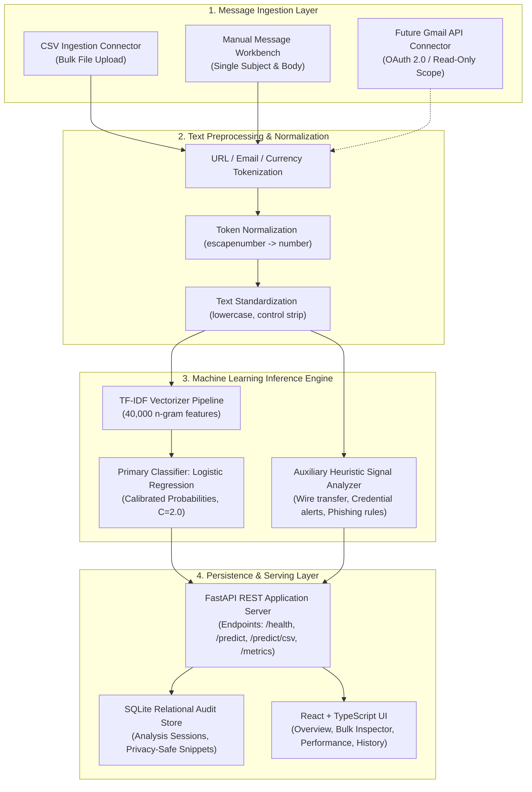
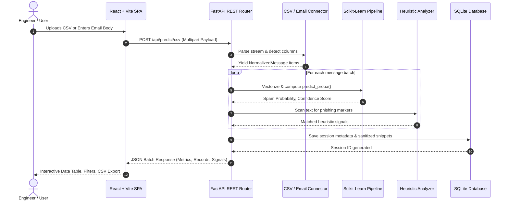

    # MailGuard AI — Architecture, Data Flow, and Engineering Viva Guide

**Project Title:** Design, Development and Implementation of an AI-Based Spam Classification System  
**System Name:** MailGuard AI  
**Author:** Third-Year Computer Engineering Project  

---

## 1. System Architecture Overview

MailGuard AI follows a strictly decoupled, modular 4-tier architecture designed for extensibility, testability, and enterprise-grade email security.



---

## 2. End-to-End Data Flow



---

## 3. Dataset Audit & Data Quality Findings

The system was trained and evaluated on an authentic Kaggle email spam corpus:

- **Total Training Volume:** 155,074 valid email records (`train_dataset.csv`, 261.39 MB).
- **Held-Out Test Volume:** 38,768 valid email records (`test_dataset.csv`, 64.35 MB).
- **Class Balance:**
  - Legitimate (Ham): **52.70%** (81,723 train / 20,430 test)
  - Spam: **47.30%** (73,351 train / 18,338 test)
- **Data Quality Anomalies Handled:**
  - **Mixed Character Encodings:** Resolved non-UTF-8 characters via Latin-1 streaming fallback.
  - **Kaggle Token Artifacts:** Preprocessing translates `escapenumber` tokens to standardized numeric markers.
  - **Multiline Malformations:** Handled unescaped newline quotes and filtered 292 malformed lines without silent data loss.

---

## 4. Empirical Model Evaluation & Comparison

Both models were fitted strictly on training data (`X_train`) and evaluated on the held-out test data (`X_test`), guaranteeing **zero data leakage**:

| Evaluation Metric | Logistic Regression (Selected Primary) | Multinomial Naive Bayes (Baseline) |
| :--- | :---: | :---: |
| **Accuracy** | **98.14%** | 96.03% |
| **Spam Precision** | **97.48%** | 98.08% |
| **Spam Recall** | **98.61%** | 93.44% |
| **Spam F1-Score** | **98.04%** | 95.70% |
| **ROC-AUC Score** | **0.9979** | 0.9953 |
| **False Positives (Ham as Spam)** | 468 (2.29%) | 335 (1.64%) |
| **False Negatives (Spam as Ham)** | **255 (1.39%)** | 1,203 (6.56%) |
| **Inference Time per 10k items** | ~0.15s | ~0.08s |

### 2x2 Confusion Matrix Analysis (38,768 Test Messages)

#### Logistic Regression (Production Pipeline):
```
                       PREDICTED HAM         PREDICTED SPAM
ACTUAL HAM (20,430):   19,962 (TN)            468 (FP)
ACTUAL SPAM (18,338):     255 (FN)         18,083 (TP)
```

#### Multinomial Naive Bayes (Baseline):
```
                       PREDICTED HAM         PREDICTED SPAM
ACTUAL HAM (20,430):   20,095 (TN)            335 (FP)
ACTUAL SPAM (18,338):   1,203 (FN)         17,135 (TP)
```

---

## 5. College Project Viva Preparation: Key Questions & Answers

### Q1: Why did you choose Logistic Regression over Naive Bayes as your production model?
> **Answer:** While Multinomial Naive Bayes is a classic text baseline with slightly fewer false positives (335 vs 468), it produced over **1,203 false negatives** (spam emails slipping into the user's inbox). Logistic Regression reduced false negatives to just **255**, achieving a superior Spam Recall of **98.61%** and Spam F1-Score of **98.04%**. In addition, Logistic Regression provides well-calibrated posterior probabilities (`predict_proba`), allowing the system to assign accurate confidence and risk tiers (High, Medium, Low).

### Q2: How did you ensure there was no data leakage during text vectorization?
> **Answer:** Text tokenization, vocabulary generation, and IDF (Inverse Document Frequency) weights were calculated strictly by calling `.fit()` only on the training subset (`train_dataset.csv`). The held-out test dataset was only transformed using `.transform()`. This ensures the model had zero foreknowledge of word frequencies or vocabulary distributions present in unseen test emails.

### Q3: Why is Spam treated as the positive class?
> **Answer:** In binary security classification, the anomalous or targeted event is designated as class 1 (positive). Here, Spam is class 1 and Ham is class 0. When we calculate Precision and Recall, Precision answers *"Of all emails flagged as spam, what fraction was actually spam?"* and Recall answers *"Of all spam emails in existence, what percentage did we catch?"*

### Q4: Why is Accuracy alone insufficient for evaluating a spam classifier?
> **Answer:** Accuracy computes $(TP + TN) / Total$. In unbalanced datasets or security contexts, accuracy treats both error types as equal. In email filtering, a False Positive (marking a critical job offer or client email as spam) is far more damaging than a False Negative (a promotional discount in the inbox). Therefore, Precision, Recall, and the harmonic mean (F1-Score) must be reported alongside confusion matrices.

### Q5: How is your system architected for future Gmail integration?
> **Answer:** We implemented the **Abstract Connector Pattern** (`BaseEmailConnector`). The machine learning classifier never touches raw files or network streams directly; it only accepts standardized `NormalizedMessage` objects (id, subject, sender, body). The future `GmailConnector` simply inherits from this class and utilizes Google OAuth 2.0 with the read-only scope `https://www.googleapis.com/auth/gmail.readonly` to stream messages into the same ML inference pipeline without changing a single line of model code.
