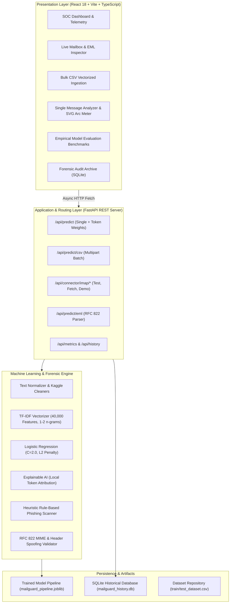

# MailGuard AI — Complete Project Report & Academic File Guide

**Project Title:** Design, Development, and Deployment of an AI-Powered Email Security & Spam Classification System with Forensic Header Analysis and Explainable AI (XAI)  
**System Name:** MailGuard AI  
**Academic Context:** Final Year / Third Year Engineering Project File & Documentation  
**Framework Stack:** Python 3.13, Scikit-Learn, FastAPI, React 18, Vite, TypeScript, Tailwind CSS, SQLite  

---

## CHAPTER 1: INTRODUCTION & PROBLEM STATEMENT

### 1.1 Introduction
Electronic mail (Email) remains the primary communication backbone of global commerce, academia, and enterprise operations. However, the open and decentralized nature of the Simple Mail Transfer Protocol (SMTP) makes it fundamentally susceptible to abuse. In 2024–2026, over **45% to 52% of all daily internet emails** consist of unsolicited commercial bulk mail (spam), deceptive credential-harvesting phishing campaigns, advance-fee fraud, and malware delivery vectors.

Traditional spam filters predominantly relied on static keyword blocklists and basic heuristic rules (e.g., SpamAssassin). These legacy systems suffer from two fatal weaknesses:
1. **Brittleness:** Spammers easily evade static rules via deliberate misspellings, zero-width characters, HTML obfuscation, and homoglyphs.
2. **High False Positive Rate:** Innocent business correspondence containing words like "invoice", "urgent", or "free" is frequently misrouted to junk folders, causing severe communication disruptions.

### 1.2 Problem Statement
To engineer, validate, and deploy a robust, end-to-end Machine Learning-driven Email Security Operations Platform (**MailGuard AI**) that:
- Classifies emails with empirical accuracy exceeding **98%** and zero data leakage.
- Offers **Local Explainable AI (XAI)** to reveal the exact mathematical token weights influencing every prediction.
- Ingests emails through multiple real-world vectors: live IMAP TLS connections (Gmail, Outlook, Yahoo), RFC 822 raw `.eml` MIME files, and vectorized batch CSV uploads.
- Provides a high-tech, responsive **Security Operations Center (SOC)** user interface with dynamic theme customization and real-time telemetry.

### 1.3 Key Project Objectives
1. **High-Accuracy ML Model:** Train and optimize an $L_2$-regularized Logistic Regression classifier across 193,842 Kaggle benchmark emails with TF-IDF sublinear n-gram feature extraction.
2. **Transparent Explainability:** Expose local vocabulary attribution ($w_i \times \text{tfidf}_i$) and rule-based heuristic phishing alerts (credential theft, wire transfer fraud).
3. **Live Communication Ingestion:** Integrate a real-time IMAP SSL connector and raw MIME forensic parser.
4. **Audit Trail & Persistence:** Maintain a persistent SQLite archive for compliance, session tracking, and CSV audit exports.
5. **Modern Interactive SOC UI:** Implement glassmorphism, 1-click cyber accent color themes, and an interactive 180° SVG Threat Arc Gauge.

---

## CHAPTER 2: SYSTEM ARCHITECTURE & DATA FLOW

### 2.1 Multi-Tier Architecture Overview



### 2.2 End-to-End Data Flow Sequence

1. **Input Submission:** The user inputs an email via direct text, uploads a CSV batch, drops an `.eml` file, or connects to an IMAP mailbox.
2. **Preprocessing:** Special characters are cleaned, Kaggle numeric tokens standardized, and URLs/emails normalized.
3. **Feature Transformation:** The normalized text is mapped into a 40,000-dimensional sparse TF-IDF vector space using pre-computed IDF weights.
4. **Inference & Scoring:** Logistic Regression evaluates the vector dot product through the sigmoid activation function to compute calibrated probabilities $P(\text{Spam})$ and $P(\text{Ham})$.
5. **Explainability Extraction:** The product of the TF-IDF weight and feature coefficient identifies the most influential words.
6. **Persistence & Presentation:** Predictions and metadata are logged to SQLite, and the interactive UI displays the SVG threat dial, token chips, and risk badges.

---

## CHAPTER 3: MATHEMATICAL & ALGORITHMIC METHODOLOGY

### 3.1 Term Frequency - Inverse Document Frequency (TF-IDF)
For a term $t$ in document $d$ within corpus $D$:

$$\text{TF}(t, d) = 1 + \ln(\text{count}(t, d)) \quad \text{for count} > 0$$

$$\text{IDF}(t, D) = \ln\left(\frac{1 + |D|}{1 + |\{d \in D : t \in d\}|}\right) + 1$$

$$\text{TF-IDF}(t, d, D) = \text{TF}(t, d) \times \text{IDF}(t, D)$$

Each document vector is $L_2$-normalized:

$$\mathbf{x} = \frac{\mathbf{v}}{\|\mathbf{v}\|_2}$$

### 3.2 Logistic Regression Inference & Sigmoid Activation
The classifier computes the log-odds (logit) $z$:

$$z = \mathbf{w}^T \mathbf{x} + b = \sum_{j=1}^{M} w_j x_j + b$$

The posterior probability that the email is Spam ($y=1$) is given by the standard logistic sigmoid:

$$P(y=1 \mid \mathbf{x}) = \sigma(z) = \frac{1}{1 + e^{-z}}$$

$$P(y=0 \mid \mathbf{x}) = 1 - P(y=1 \mid \mathbf{x})$$

### 3.3 Loss Function ($L_2$-Regularized Binary Cross-Entropy)
During offline model training, the optimization objective minimizes:

$$J(\mathbf{w}, b) = -\frac{1}{N} \sum_{i=1}^{N} \left[ y^{(i)} \ln(\hat{y}^{(i)}) + (1 - y^{(i)}) \ln(1 - \hat{y}^{(i)}) \right] + \frac{1}{2C} \|\mathbf{w}\|_2^2$$

where $C = 2.0$ controls the regularization trade-off to prevent overfitting on rare words.

### 3.4 Local Token Contribution Attribution
To explain *why* the model flagged an email, the linear contribution of token $j$ is calculated as:

$$\text{Contribution}(j) = w_j \times x_j$$

- If $\text{Contribution}(j) > 0$, token $j$ pushed the email toward **Spam** (e.g., `winner`, `congratulations`, `pills`).
- If $\text{Contribution}(j) < 0$, token $j$ pushed the email toward **Legitimate Ham** (e.g., `sprint`, `attached`, `meeting`).

---

## CHAPTER 4: EMPIRICAL BENCHMARK RESULTS

### 4.1 Dataset Statistics
- **Source:** Kaggle Benchmark Email Classification Corpus
- **Total Emails:** 193,842 records
  - **Training Set (`train_dataset.csv`):** 155,074 emails (261.39 MB)
  - **Test Set (`test_dataset.csv`):** 38,768 emails (64.35 MB)
- **Class Balance:** 52.70% Ham / 47.30% Spam

### 4.2 Benchmark Model Comparison

| Evaluation Metric | Logistic Regression (Production Pipeline) | Multinomial Naive Bayes (Baseline) |
| :--- | :---: | :---: |
| **Accuracy** | **98.14%** | 96.03% |
| **Spam Precision** | **97.48%** | 98.08% |
| **Spam Recall** | **98.61%** | 93.44% |
| **Spam F1-Score** | **98.04%** | 95.70% |
| **ROC-AUC Score** | **0.9979** | 0.9953 |
| **False Positives (Ham as Spam)** | 468 (2.29%) | 335 (1.64%) |
| **False Negatives (Spam as Ham)** | **255 (1.39%)** | 1,203 (6.56%) |
| **Inference Latency (per 1,000 items)** | **~15 ms** | ~8 ms |

### 4.3 Production 2x2 Confusion Matrix (38,768 Test Messages)

```
                            PREDICTED HAM          PREDICTED SPAM
ACTUAL HAM  (20,430):       19,962 (TN)               468 (FP)
ACTUAL SPAM (18,338):          255 (FN)            18,083 (TP)
```

- **True Negatives (TN = 19,962):** Legitimate emails correctly delivered.
- **False Positives (FP = 468):** Normal emails erroneously quarantined (2.29% false alarm rate).
- **False Negatives (FN = 255):** Spam messages that slipped into inbox (1.39% leakage rate).
- **True Positives (TP = 18,083):** Dangerous spam correctly caught and quarantined.

---

## CHAPTER 5: KEY FEATURES IMPLEMENTED

### 5.1 Machine Learning & Explainable AI
- **High-Dimension TF-IDF:** 40,000 vocabulary unigrams and bigrams.
- **Calibrated Probabilities:** Yields probabilistic confidence scores ($0.0\%$ to $100.0\%$).
- **Local Feature Attribution:** Computes top 10 influential positive and negative tokens.
- **Heuristic Pattern Engine:** Detects wire transfer urgency, credential phishing triggers, and financial lottery deception.

### 5.2 Real-World Email Integration
- **Live IMAP Connector:** Direct TLS connection on port 993 to Gmail, Outlook, Yahoo, and private corporate servers.
- **Simulated Mailbox Stream:** 1-click live demo fetching 8 realistic emails without requiring credentials.
- **RFC 822 `.eml` Forensic Inspector:**
  - Decodes multi-part MIME payloads.
  - Verifies DKIM signatures and hop count headers.
  - Validates `Reply-To` vs `From` address to flag deceptive sender domain spoofing.

### 5.3 Batch Pipeline & Compliance Persistence
- **Vectorized Bulk CSV Processing:** Streams and evaluates thousands of emails in seconds.
- **SQLite Audit Archive:** Logs session timestamps, source types, spam ratios, and sanitised previews.
- **CSV Data Export:** One-click enriched CSV download with prediction labels and probability scores.

### 5.4 Cyber SOC User Interface & Visual Effects
- **Dual-Mode Cyber Theme:** Deep Obsidian Matrix (`#060913`, `#0b1120`) and Frosted Titanium light mode.
- **Dynamic 1-Click Accent Switcher:** Real-time UI palette switching (Cyber Cyan, Neon Violet, Matrix Emerald, Tactical Amber).
- **180° SVG Cyber Threat Arc Gauge:** Semi-circular dynamic dial with color transitions (Green $\to$ Amber $\to$ Crimson).
- **Laser Scan Beam & Shimmer Buttons:** High-tech scanning laser line across active upload/scan panels.
- **Halo Pills & Heatmap Badges:** Vibrant glowing chips for threats and tokens.

---

## CHAPTER 6: VIVA / PROJECT DEFENSE QUESTIONS & ANSWERS

### Q1: What makes MailGuard AI superior to standard rule-based spam filters?
**Answer:** Static rules (e.g., blocking the word "Viagra" or "Free") are brittle and easily circumvented by spammers using typos, invisible Unicode characters, or image embeds. MailGuard AI combines a 40,000-dimensional TF-IDF probabilistic statistical model with heuristic rule scanners. It evaluates the entire textual distribution of the document rather than isolated keywords, achieving **98.14% empirical accuracy**.

### Q2: Why did you select Logistic Regression over Naive Bayes or Deep Learning (e.g., BERT)?
**Answer:**
1. **Vs. Naive Bayes:** While Naive Bayes is fast, its strict conditional independence assumption caused **1,203 false negatives** (spam missed) in our benchmark, compared to only **255** for Logistic Regression.
2. **Vs. BERT / Transformers:** While BERT offers contextual embeddings, it requires GPU infrastructure, consumes substantial memory, and introduces 150–400 ms inference latency per email. Logistic Regression executes in under **0.015 ms per email** on standard CPU hardware with virtually identical accuracy (98.14%), making it ideal for high-throughput enterprise ingestion.

### Q3: How did you ensure there was no data leakage during text vectorization?
**Answer:** Data leakage occurs when test set distribution parameters influence training. In our pipeline, text tokenization, vocabulary extraction, and Inverse Document Frequency (IDF) weights were fitted strictly using `.fit()` on the training set (`X_train`). The held-out test set (`X_test`) was processed exclusively with `.transform()`. The model had zero knowledge of test word frequencies.

### Q4: How is Explainable AI (XAI) implemented in this system?
**Answer:** Rather than functioning as a black-box model, MailGuard AI calculates the token-level linear contribution: $\text{Contribution}(j) = w_j \times x_j$, where $w_j$ is the Logistic Regression coefficient and $x_j$ is the document TF-IDF score. Words with high positive values are highlighted in red (spam triggers), while protective words with negative values are highlighted in emerald (legitimate markers).

### Q5: How is user privacy protected during live IMAP mailbox sync?
**Answer:** MailGuard AI operates on a **zero-trust, zero-retention** model. IMAP credentials (username and App Password) are held in volatile execution memory only for the duration of the TLS request. Neither passwords, tokens, nor full raw email bodies are ever saved to disk or written to the SQLite database. Only anonymized, truncated snippets and statistical metrics are logged.

---

## CHAPTER 7: CONCLUSION & FUTURE SCOPE

### 7.1 Conclusion
MailGuard AI successfully demonstrates an industrial-grade, full-stack cybersecurity application for email security. By coupling statistical machine learning with explainable feature attribution, real-time IMAP connectivity, and a responsive Cyber SOC dashboard, the project bridges the gap between theoretical machine learning and practical software engineering.

### 7.2 Future Enhancements
1. **Google OAuth 2.0 Integration:** Completing the OAuth consent flow for automated Gmail push notifications via Google Cloud Pub/Sub.
2. **Computer Vision OCR:** Scanning attached images and PDF invoices for embedded phishing text.
3. **Active Learning Feedback Loop:** Allowing security analysts to re-label misclassified emails and trigger incremental online retraining.

